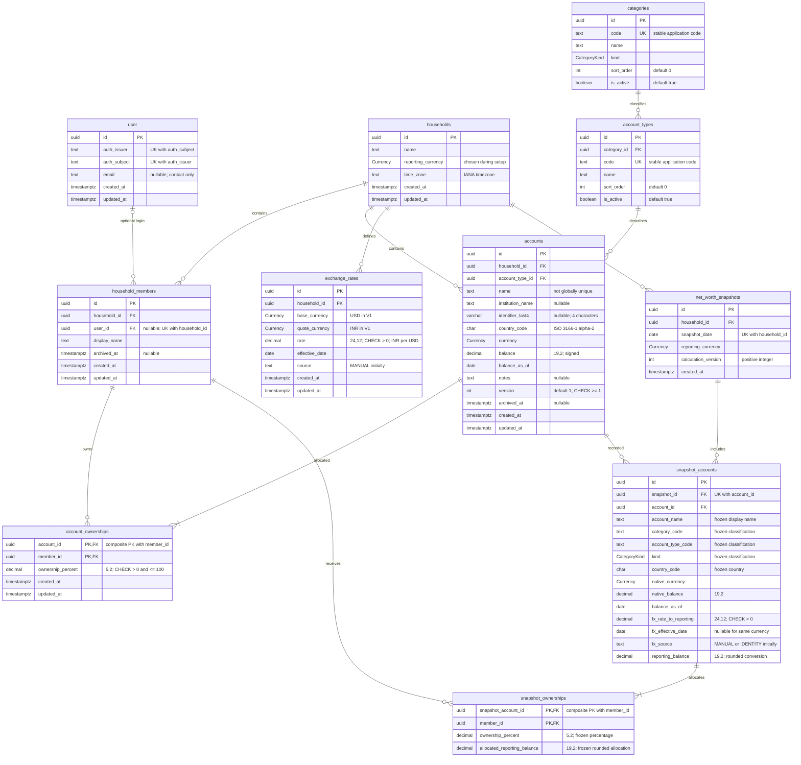
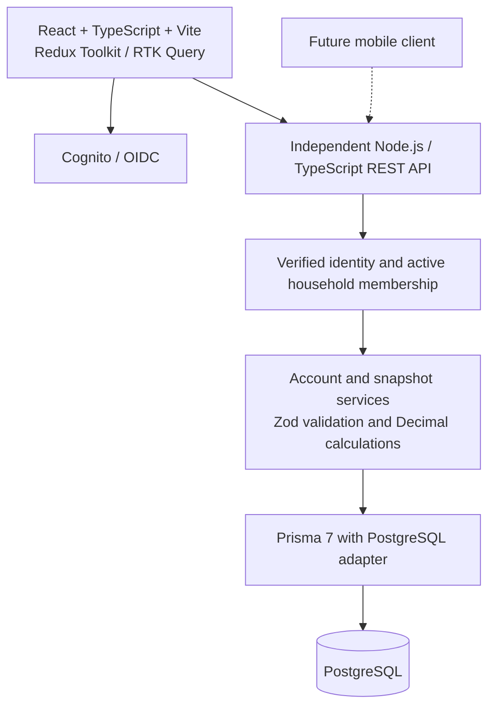

# perfin v2 — Family net-worth database design

Scope: family members, individual and joint accounts, assets and liabilities, USD/INR reporting, and dated snapshots. Goals, transactions, investment holdings, imports, and configurable sharing permissions are deferred.

This document describes the intended schema; it does not mean that Prisma models or migrations have been implemented.

## Identity, access, and financial ownership

- A household groups the family's members, accounts, exchange rates, and reporting settings.
- A household member represents a person. Linking a login is optional, so a spouse can have financial ownership without an application login.
- Proposed V1 access policy: both linked, active household members can manage the household's financial records. Confirm this policy before implementing authentication. Household membership grants access; financial ownership percentages do not.
- Every financial operation must verify the authenticated principal's active household membership. A client-supplied household ID is not authorization.
- A member's login must be linked through an authorized operation, never automatically by matching a name or email.
- An account stores its entire balance once. Member amounts are derived from its ownership rows; do not create duplicate accounts for joint owners.

## Conventions

- Primary IDs: UUIDs. Composite primary keys are indicated below.
- Money: `Decimal(19,2)`; use decimal arithmetic and transmit money as decimal strings.
- Ownership: `Decimal(5,2)`, expressed as percentages, for example `50.00`.
- FX rates: `Decimal(24,12)`.
- Business dates: PostgreSQL `DATE`; audit timestamps: `TIMESTAMPTZ(3)`.
- Currency enum: `USD`, `INR`. Category kind enum: `ASSET`, `LIABILITY`.
- SQL names below use snake_case; Prisma fields should use camelCase with `@map`/`@@map`.
- The Prisma model is `User`, mapped with `@@map("user")` to the singular PostgreSQL table `"user"`. Quote this table name in raw SQL, for example `SELECT * FROM public."user"`.
- `nullable` means optional. Other fields are required.
- `created_at` defaults to now; mutable model `updated_at` is maintained by Prisma.

## Entity relationship diagram

Key: `PK` primary key, `FK` foreign key, `UK` unique key. Composite constraints are described in comments and in the rules below.

## Classification

The seed provides 38 account types across these 7 categories. See the [complete V1-to-V2 mapping](v1-v2-account-type-mapping.md); the table below contains examples, not the full catalog.

Categories and account types are application-managed reference data for V1. An account references only its account type; derive its category and kind through that type.

| Category code | Kind | Example account types |
|---|---|---|
| CASH | ASSET | Checking, savings, fixed deposit |
| INVESTMENTS | ASSET | Brokerage, mutual funds |
| RETIREMENT | ASSET | 401(k), IRA, EPF, PPF |
| REAL_ESTATE | ASSET | Home, land |
| PERSONAL_PROPERTY | ASSET | Vehicle, valuables |
| LOANS | LIABILITY | Mortgage, auto loan, personal loan |
| CREDIT | LIABILITY | Credit card, line of credit |

Foreign assets are a country-based reporting filter, not a category. Country and currency are independent. Account also represents manually valued property, so institution and identifier fields are optional. Full account numbers are not needed for this scope.

## Keys, indexes, and integrity rules

### Unique constraints

- User (`"user"` table): `(auth_issuer, auth_subject)`. Email is not the identity or authorization key.
- Household members: `(household_id, user_id)`. PostgreSQL permits multiple unlinked members because `user_id` is nullable.
- Categories and account types: globally unique stable `code` in each table.
- Account ownerships: composite primary key `(account_id, member_id)`.
- Exchange rates: `(household_id, base_currency, quote_currency, effective_date)`.
- Net-worth snapshots: `(household_id, snapshot_date)`.
- Snapshot accounts: `(snapshot_id, account_id)`.
- Snapshot ownerships: composite primary key `(snapshot_account_id, member_id)`.
- Account names and identifier hints are not unique.

### Suggested supporting indexes

Index household members by `user_id`; accounts by `(household_id, archived_at)` and `account_type_id`; account types by `category_id`; account ownerships by `member_id`; snapshot accounts by `account_id`; snapshot ownerships by `member_id`. The unique keys above also support household FX and snapshot date lookups.

### Ownership and concurrent changes

- Every account has at least one owner, all in the same household as the account.
- Percentages are greater than zero and sum to exactly `100.00` per account.
- Derive joint status from the number of ownership rows; do not store `is_joint`.
- Create an account and all its ownership rows in one transaction.
- Replace ownership sets atomically; lock the account row and verify/increment its `version` for balance, metadata, and ownership changes. Conflicting updates must fail rather than overwrite.
- Range checks belong in migration SQL. Ownership sums, same-household relations, and minimum owner counts are not enforced by the simple foreign keys shown here. Enforce them in the transactional service; add composite household FKs or database triggers if database-level enforcement is required.
- Prevent archiving a member while they own an active account until ownership is explicitly reassigned. Historical ownership rows remain intact.

### Balance and conversion rules

- Positive asset balances mean value owned; negative asset balances can represent overdrafts.
- Positive liability balances mean amounts owed; negative liability balances can represent credit balances.
- Net worth equals converted asset balances minus converted liability balances.
- Do not impose a blanket nonnegative balance or total constraint.
- For V1 store only USD-to-INR rates: `rate` is INR per USD. Convert USD to INR by multiplication, INR to USD by division. Use SQL checks for the fixed currency direction and positive rate.
- Use the latest rate effective on or before the reporting date. Display its date and balance ages; never silently substitute rate 1 for a missing cross-currency rate.
- Same-currency conversion uses rate 1 and source `IDENTITY`.
- Calculate with decimal arithmetic. Round account reporting balances to two decimals using an explicitly tested rounding rule. Allocate member rounding remainders deterministically, including negative balances, so member amounts sum exactly to the account balance.
- Household totals count each account once. Member totals use ownership allocations.
- An account's native currency must not be relabeled without an explicit balance conversion/correction workflow; normal editing treats it as fixed.

### Snapshot consistency

- Snapshots capture active accounts and their complete ownership sets in one consistent database transaction. Use an isolation strategy that prevents mixed reads during concurrent account, ownership, or FX updates.
- Snapshot header, account rows, and member allocations are saved atomically.
- Snapshot account and member references must belong to the snapshot's household; enforce this in the service, since the basic FKs do not prove it.
- Freeze classification, native balance, balance date, conversion rate/date/source, converted balance, and ownership allocations. Recalculate historical totals from these frozen rows, not current accounts or current rates.
- Frozen ownership percentages total 100%; frozen allocated amounts reconcile to each snapshot account's reporting balance.
- Snapshots are immutable through normal application operations. A duplicate household/date is rejected rather than silently overwritten.
- Changing the household reporting currency does not rewrite prior snapshots. Historical charts must not combine amounts denominated in different currencies without an explicit conversion policy; initially group/filter by reporting currency.
- The first UI captures today's recorded position using the household timezone and displays each balance's age. It cannot reconstruct an arbitrary historical position from current balances. Backdated capture/import is a separate future workflow.

### Lifecycle

- Archive accounts and members instead of deleting records referenced by history. Archived accounts are excluded from new current totals and snapshots.
- Use restrictive foreign-key deletion behavior for household, account, member, and reference-data links. Do not cascade deletion of a login into financial records.
- Unlink a user's login explicitly before deleting that identity. Archived memberships grant no access.
- Snapshot totals are derived from frozen account rows; avoid hardcoded columns per category.

## Application architecture

Local development uses Docker PostgreSQL and a Node API. Future AWS hosting uses S3/CloudFront for the frontend, Cognito and API Gateway for authenticated requests, a Lambda API container, and private RDS PostgreSQL. The browser never accesses Prisma or PostgreSQL directly.

## Implementation checkpoints

1. Review this ERD and the proposed household access policy. Align the older session plan and project instructions before implementation; their private-user model, goals, and imports are superseded by this document's scope.
2. Translate the models into `packages/db/prisma/schema.prisma` using the package's pinned Prisma 7 setup. Format and validate only.
3. Generate migration SQL against an isolated development database; review constraints and deletion behavior before applying it.
4. Apply the reviewed migration and generate Prisma Client. Seed reference data and explicitly enabled synthetic fixtures only.
5. Test foreign keys, ownership rules, household access denial, concurrent edits, decimal conversion/rounding, duplicate snapshot dates, and atomic snapshot failure. Use Vitest plus disposable PostgreSQL for database behavior.
6. Build household access and account services first, then current net-worth calculations, then snapshot capture and history. Review each increment together before proceeding.

No existing application database is migrated by this design. Migrating original records requires a separate, reviewed mapping and reconciliation process.
